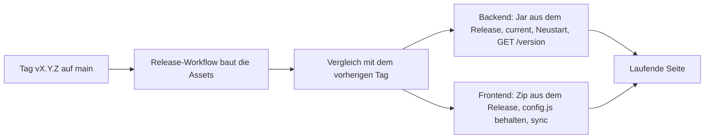

# Deployment

OpenTofu baut die leere Maschine und die Website. Welche Version läuft, steht nicht in OpenTofu. Ein neues Release braucht kein `tofu apply` und keine neue Instanz.

Das IaC-Projekt lag nicht in diesem Repository. `infra/` enthält deshalb die Instanz aus dem IaC-Auftrag und die Erweiterung für die Web-Konsole.

## Warum das Jar nicht in user_data steht

`user_data` läuft beim ersten Start. Liegt das Jar dort, bleibt eine neue Version liegen, bis die Instanz neu entsteht. `user_data_replace_on_change = true` würde die Instanz bei jeder Versionsänderung zerstören. Die Adresse und die laufende Partie hängen dann am Release. Das ist die Kopplung, die dieser Auftrag trennt.

Die Instanz liest `s3://<artifact-bucket>/current`. Darin steht nur `X.Y.Z`. Jar und `tictactest-webconsole-X.Y.Z.zip` liegen unter `releases/X.Y.Z/`. Der Dienst holt genau diese Dateien, bevor er startet. Nach einem Neustart ist `current` noch dieselbe Datei, also startet dieselbe Version.

GitHub direkt von der Instanz wäre auch möglich, solange das Repo öffentlich ist. Wird es privat, braucht die Instanz einen Token. Den legen wir nicht auf die Platte. Der private Bucket und `LabInstanceProfile` kommen ohne Access Key aus. Die Rolle existiert im Lab schon. Ein `resource "aws_iam_role"` ist im Learner Lab verboten.

## Was nie in den öffentlichen Bucket darf

Der Website-Bucket ist weltweit lesbar. Dort liegen nur die statischen Seiten: HTML, CSS, JS, `version.txt` und `config.js`.

Nicht dort: das Jar, das Startskript, `version-server.py`, SSH-Schlüssel, AWS-Zugangsdaten, der State, der Inhalt des Artefakt-Buckets.

`config.js` schreibt OpenTofu mit der Elastic IP. Das Release-Zip enthält die lokale Adresse `127.0.0.1`. Der Deploy kopiert zuerst die `config.js` aus dem Bucket über die Datei aus dem Zip und synchronisiert erst dann. Ein späteres Frontend-Release überschreibt die Adresse der Instanz nicht.

## Ports

| Port | Wer | Warum |
|---|---|---|
| 22 | nur `ssh_cidr` | Deploy und Fehlersuche per SSH |
| 7681 | Browser | ttyd. Die Seite auf S3 bettet diese Adresse ein |
| 7682 | Browser und Pipeline | `GET /version` |
| 443 raus | die Instanz | Corretto, ttyd, S3, SSM |
| 53 UDP raus | die Instanz | DNS |

Port 80 auf der Instanz bleibt zu. Die Seite kommt von S3.

Die Default-Route-Tabelle im Lab hatte kein Ziel für `0.0.0.0/0`, obwohl das Internet Gateway schon hing. Ohne `aws_route.public` kommt die Instanz nicht ins Netz: SSH läuft ins Timeout, `dnf` bleibt hängen, SSM registriert sich nicht. Die Instanz hängt von dieser Route ab, damit der erste Start das Netz schon hat.

## Speicher

`t3.micro` hat 1 GB. Jeder Tab startet eine JVM (`-Xmx64m`) plus den Rest der JVM. Zwei bis drei gleichzeitige Partien passen, mehr verdrängt der Speicher.

## Outputs

Öffentlich und kein Geheimnis: `frontend_url`, `console_url`, `version_url`, `public_ip`.

Nur für das Deployment, nicht geheim, aber nicht auf die Webseite: `instance_id`, `artifact_bucket`, `frontend_bucket`, `aws_region`.

Geheim und nicht im Git: der private SSH-Schlüssel, die AWS-Session-Keys aus dem Lab, `infra/terraform.tfvars`, `*.tfstate`.

## Infrastruktur anlegen

Im Lab die Zugangsdaten in die Shell legen. Nicht ins Repo schreiben.

```sh
cd infra
cp terraform.tfvars.example terraform.tfvars
```

In `terraform.tfvars`: Region des Labs, `key_name` aus dem IaC-Auftrag, `ssh_cidr` als die eigene öffentliche Adresse mit `/32`.

```sh
tofu init
tofu plan
tofu apply
```

Danach existieren Instanz, feste IP und leere Buckets. `config.js` liegt schon im Website-Bucket. Der Dienst ist enabled und startet noch nichts Sinnvolles, weil `current` fehlt.

Das Learner Lab verbietet `s3:GetBucketObjectLockConfiguration`. Die Ressource `aws_s3_bucket` liest das bei jedem Plan und scheitert. Deshalb legt OpenTofu die Buckets mit der AWS-CLI an und verwaltet danach Policy, Website und `config.js`. Die Seite muss öffentlich lesbar sein, sonst sieht der Browser sie nicht.

## Release von Hand

Release A ist `1.1.0`.

```sh
sh ops/deploy-release.sh 1.1.0
```

Das Script lädt nur die drei Assets von GitHub, kopiert Jar und Webconsole-Zip in den privaten Bucket, schreibt `current` und startet den Dienst neu. Es wartet, bis der SSM-Befehl fertig ist, und bricht mit der Ausgabe der Instanz ab, wenn der Neustart scheitert. Danach legt es das Frontend hoch. `version_url` und `frontend_url/version.txt` müssen beide `1.1.0` sagen.

Im Browser die `frontend_url` öffnen und eine Partie spielen.

Wenn SSM im Lab verweigert wird, dieselbe Wirkung per SSH:

```sh
ssh -i <privater-schluessel> ec2-user@$(tofu -chdir=infra output -raw public_ip) sudo systemctl restart tictactest
```

SSM ist der Weg für die spätere Pipeline. Der Befehl geht über HTTPS, die Instanz nimmt ihn mit `LabInstanceProfile` an. Port 22 bleibt zu, und es liegt kein privater Schlüssel im Workflow. Die Runner-Adresse von GitHub Actions wechselt, deshalb passt sie nicht in `ssh_cidr`. SSH zeigt die Ausgabe direkt und hilft, wenn der Agent noch nicht online ist. Dafür muss der Schlüssel auf dem Rechner liegen, der den Befehl schickt.

### Zweiter Release, ohne neue Infrastruktur

Eine sichtbare Änderung nur im Frontend, zum Beispiel ein Satz in `frontend/index.html`. Abschnitt in `CHANGELOG.md`, Commit, Tag `v1.2.0`, warten bis der Release die drei Assets hat.

```sh
tofu -chdir=infra plan
sh ops/deploy-release.sh 1.2.0
```

Am 25. November 2026 zeigte `tofu plan` keine Änderung. Die Instanz blieb `i-0b6ad65259d45cf83`, die Adresse `184.32.11.203`. `sh ops/deploy-release.sh 1.2.0` lief ohne `tofu apply`. Die Seite zeigte den neuen Satz, Backend `1.2.0` und Frontend `1.2.0`. `config.js` zeigte weiter auf `184.32.11.203`.

## Teil 4

Die Versuche liefen am 25. November 2026 im Learner Lab, Konto `944243916503`, Region `us-west-2`.

1. Die Lab-Session selbst wurde nicht beendet. Das würde die Zugangsdaten ungültig machen, und die weiteren Versuche wären stehen geblieben. Was die Session mit der Maschine macht, ist Stop und Start. Genau das ist gelaufen, während `1.2.0` aktiv war. Vorher und nachher: Elastic IP `184.32.11.203`, Instanz `i-0b6ad65259d45cf83`. Im gestoppten Zustand zeigte die Adresse dieselbe IP. Nach dem Start antwortete `http://184.32.11.203:7682/version` beim ersten Abruf mit `1.2.0`. Es gab keinen Deploy-Befehl dazwischen. systemd startet den enabled Dienst, `fetch.sh` liest dasselbe `current`.

2. In `infra/templates/tictactest.service` stand testweise `Environment=TICTACTEST_NOTE=teil4`. Diese Datei steckt in `user_data`. `tofu plan` dazu:

```
# aws_instance.web will be updated in-place
id = "i-0b6ad65259d45cf83"
~ user_data = (alter Hash) -> (neuer Hash)
~ public_ip = "184.32.11.203" -> (known after apply)
Plan: 0 to add, 1 to change, 0 to destroy.
```

Die Elastic IP war nicht im Plan. Die Instanz wird nicht ersetzt, weil `user_data_replace_on_change` falsch ist. Der Plan wurde nicht angewendet, die Zeile ist wieder weg. Adresse und Version blieben `184.32.11.203` und `1.2.0`. `user_data` läuft nur beim ersten Start. Eine angewendete Variable landet in den gespeicherten User Data und erscheint in der laufenden Unit erst, wenn die Unit-Datei neu geschrieben oder die Instanz ersetzt wird. Eine App-Version ändert `user_data` nicht.

3. `tofu destroy` hat 12 Ressourcen gelöscht, danach `tofu apply` 12 neue angelegt.

| | vorher | nachher |
|---|---|---|
| öffentliche IP | `184.32.11.203` | `32.184.161.188` |
| Instanz | `i-0b6ad65259d45cf83` | `i-07c5ac3482c360423` |
| Elastic IP | `eipalloc-0ad345d94fbf6d340` | `eipalloc-0389c8dcb2300bc40` |
| Security Group | `sg-0086fe2640d26f645` | `sg-0ec1abcb0427c6720` |
| Artefakt-Bucket | `tictactest-artifacts-944243916503` | derselbe Name, leerer neuer Bucket |
| Website-Bucket | `tictactest-frontend-944243916503` | derselbe Name, leerer neuer Bucket |
| `frontend_url` | unverändert, der Name hängt an der Konto-ID | gleich |

`current`, beide Jars und die Website-Dateien waren weg. `config.js` enthielt die neue IP. Der Dienst war enabled und inactive. `sh ops/deploy-release.sh 1.2.0` hat dieselbe Version wieder hingestellt. Die Seite zeigt Backend `1.2.0` und Frontend `1.2.0`, das Terminal nimmt den Zug `4` an. Bis zu diesem Deploy lief kein Spiel.

## Secrets

Die Pipeline deployt ein fertiges Release. Sie legt keine Infrastruktur an und liest den OpenTofu-State nicht. Dafür braucht sie drei kurzlebige Lab-Werte und ein paar Namen, die keine Geheimnisse sind.

Die Lab-Session liefert `AWS_ACCESS_KEY_ID`, `AWS_SECRET_ACCESS_KEY` und `AWS_SESSION_TOKEN`. Die gelten nur für diese Session, bei uns etwa drei Stunden, und sterben beim Beenden des Labs. Eine neue Session erzeugt neue Werte. Im Learner Lab darf man keine eigene IAM-Rolle anlegen, deshalb gibt es hier keinen langlebigen Schlüssel.

Diese drei Werte sind GitHub **Secrets**. Ein Secret ist verschlüsselt, in der Oberfläche nur schreibbar und in Logs maskiert. Wer das Repo schreiben darf, kann es benutzen und ersetzen, den alten Wert aber nicht wieder anzeigen. Ein Secret steht nicht im Repository, nicht in der Workflow-Datei und wird von keinem Befehl ausgegeben.

Alles andere sind GitHub **Variables**, weil es keine Zugangsdaten sind und in den Outputs schon als nicht vertraulich gilt:

| Variable | Beispiel aus diesem Lab | Wann sie sich ändert |
|---|---|---|
| `AWS_REGION` | `us-west-2` | bleibt |
| `ARTIFACT_BUCKET` | `tictactest-artifacts-944243916503` | bleibt, der Name enthält die Konto-ID |
| `FRONTEND_BUCKET` | `tictactest-frontend-944243916503` | bleibt |
| `FRONTEND_URL` | die S3-Website dieses Buckets | bleibt |
| `INSTANCE_ID` | `i-07c5ac3482c360423` | bei `tofu destroy` und neuem `apply` |
| `VERSION_URL` | `http://32.184.161.188:7682/version` | wenn die Elastic IP neu ist |

Variables sind im Klartext lesbar und dürfen in Logs erscheinen. Nach `tofu destroy` und `tofu apply` müssen `INSTANCE_ID` und `VERSION_URL` in GitHub angepasst werden, sonst trifft der Neustart die alte Instanz. Danach deployt man dieselbe Version noch einmal.

Läuft ein Release mit abgelaufenem Token, lehnt AWS den Aufruf ab. Der Job wird rot, die Fehlermeldung nennt den abgelaufenen Token. `current` bleibt unangetastet, wenn die Prüfung der Identität vor dem Schreiben passiert. Die laufende Version bleibt damit stehen. Danach eine neue Lab-Session starten, die drei Secrets ersetzen und denselben Workflow noch einmal starten.

Der Deploy startet nur bei einem Tag `v*` und bei einem manuellen Lauf. Ein Pull Request, auch von einem Fork, startet ihn nicht und bekommt die Secrets nicht. Forks erhalten Secrets von diesem Repo nicht. In Logs tauchen die Werte nur auf, wenn ein Befehl sie selbst ausgibt. Das Script gibt sie nicht aus. Nach jedem Lauf die Log-Ausgabe darauf prüfen.

Wird ein Session-Token öffentlich, kann jemand bis zum Session-Ende tun, was `LabRole` erlaubt: in die Buckets schreiben, den Dienst neu starten, weiter im Lab arbeiten. Der Schlüssel ist danach tot. Reaktion: Lab-Session beenden, neue Session starten, die drei Secrets ersetzen, in S3 nach unerwarteten Objekten sehen und die letzte bekannte Version wieder deployen. Der private SSH-Schlüssel liegt nicht in GitHub. Ihn beträfe das nicht.

In einem festen Konto ohne Lab-Sperre wäre der Weg OIDC. GitHub Actions holt für den Lauf ein kurzlebiges Token. AWS vertraut dem GitHub-OIDC-Provider und einer Rolle, deren Trust nur dieses Repository und nur Tags `v*` zulässt. Der Workflow nimmt die Rolle an und speichert keinen Schlüssel. Das Token gilt Minuten und nur für diese Rolle. Hier ist das nicht möglich, weil das Lab keine eigene Rolle erlaubt.

## Was sich seit dem letzten Release geändert hat

`ops/release-changes.sh vX.Y.Z` vergleicht den Tag mit dem vorherigen Release-Tag und gibt aus, ob Backend und Frontend deployt werden. Der vorherige Tag ist die Grenze, weil ein Release alle Commits seit dieser Grenze enthält. Der jüngste Commit davon ist nur ein Teil.

Der `paths`-Filter von GitHub Actions entscheidet, ob ein Workflow überhaupt startet, und kennt nur die Dateien des Push-Events. Ein Tag trägt die Spanne seit dem letzten Release nicht. Ein manueller Lauf hat gar keine geänderte Dateiliste. Der Job rechnet den Unterschied mit `git diff --name-only` selbst aus und braucht dafür die ganze History (`fetch-depth: 0`).

| Pfad | Teil | Warum |
|---|---|---|
| `src/main/`, `build.gradle`, `settings.gradle`, `gradle/`, Wrapper | Backend | ändert das Jar |
| `ops/start-webconsole.sh`, `ops/version-server.py` | Backend | liegen im Webconsole-Zip und starten mit dem Dienst |
| `frontend/` | Frontend | die statische Seite |
| Tests, Doku, `infra/`, Workflows, `ops/deploy-release.sh` | keins | ändert die laufende Seite nicht |

Eine Datei aus beiden Gruppen deployt beide Teile. Der erste Release hat keinen vorherigen Tag. Dann gelten beide Teile als geändert.

Gegen die vorhandenen Tags:

```text
v1.0.0  previous=none    backend=true   frontend=true
v1.1.0  previous=v1.0.0  backend=true   frontend=true
v1.2.0  previous=v1.1.0  backend=false  frontend=true
```

`v1.2.0` hat nur `frontend/index.html` und das Changelog geändert. Das Backend wäre stehen geblieben. Ein Push auf `main` deployt nichts. `.github/workflows/deploy.yml` startet bei einem Tag `v*` und von Hand über `workflow_dispatch`. Der Tag stösst zuerst den Release-Workflow an. Der Deploy wartet, bis die Assets dieses Releases abrufbar sind, und lädt genau diese Dateien. Ein Release, das der Release-Workflow mit dem eingebauten Token anlegt, startet in GitHub keinen weiteren Workflow. Deshalb hängt der Deploy am Tag und nicht am Ereignis `release`.

## Pipeline

```sh
sh ops/deploy-release.sh 1.2.0 both
sh ops/deploy-release.sh 1.2.0 backend
sh ops/deploy-release.sh 1.2.0 frontend
```

Ohne zweiten Argument deployt das Script beide Teile. Lokal liest es die Ziele aus `tofu output`. In GitHub Actions kommen sie aus Variables. `tofu apply` kommt in der Pipeline nicht vor.

Zuerst `aws sts get-caller-identity`. Schlägt das fehl, schreibt das Script weder `current` noch die Website. Ein abgelaufener Lab-Token macht den Job rot, die laufende Version bleibt.

Das Backend lädt Jar und Webconsole-Zip aus dem Release, legt sie unter `releases/X.Y.Z/` ab, schreibt `current` zuletzt und startet den Dienst neu. Danach muss `VERSION_URL` genau diese Nummer liefern, sonst ist der Job rot. Das Frontend packt das Frontend-Zip aus, kopiert die `config.js` aus dem Bucket über die Datei aus dem Zip, setzt die Zeitstempel der Dateien auf jetzt und synchronisiert mit `--delete`. `sync` lässt eine gleich grosse Datei liegen, wenn die Kopie im Bucket neuer ist. Genau das passiert bei einem Rollback, deshalb reicht der Zeitstempel aus dem Zip nicht. `version.txt` auf der Website muss die neue Nummer sein.

Zwei Läufe teilen sich die Gruppe `deploy`. Der zweite wartet, bis der erste fertig ist.

Wer während des Neustarts gerade spielt, verliert die Partie. ttyd und die JVM enden mit dem Dienst. Neu laden startet eine neue Partie. Verhindern liesse sich das mit einer zweiten Instanz und einem Wechsel der Adresse erst nach dem erfolgreichen Start. Das bauen wir nicht.

Nach einem Neustart der Maschine liest `fetch.sh` weiter `s3://…/current`. Die Nummer steht nicht in der Instanz fest.

Löscht das Frontend-Deployment die `config.js` aus der Infrastruktur, zeigt das Zip auf `127.0.0.1`. Die Seite lädt, das Spiel im iframe nicht. Das Script bricht ab, wenn das Kopieren aus dem Bucket scheitert, und synchronisiert erst danach. Die Datei im Upload ist damit die aus OpenTofu, nicht die aus dem Zip.



Ein manueller Lauf deployt beide Teile einer schon veröffentlichten Version. Damit holt man eine ältere Version zurück oder setzt nach `tofu destroy` dieselbe Version wieder auf.

## Umgebungen

Es gibt eine Umgebung. `tofu apply`, der SSH-Schlüssel und das Eintragen der Lab-Secrets bleiben manuell. Der Deploy eines Releases ist der automatische Teil.

Dieselbe Konfiguration dreimal hiesse: ein Name pro Umgebung an Buckets, Instanz und Security Group, und getrennte Variables. Gleich bleiben AMI, Instanztyp, Ports, die Unit und der Deploy-Ablauf. Unterschiedlich sind IP, Instanz-ID, Bucket-Namen und die `config.js`.

Ein Release wird einmal gebaut. Dieselben drei Assets gehen nach dev, dann staging, dann prod. Ein neuer Build pro Umgebung könnte ein anderes Jar ausliefern als das, das den Test bestanden hat. Dev startet bei einem Tag. Staging und prod starten von Hand, prod erst nach einer Required Reviewer-Regel auf der GitHub-Environment. Vor prod muss die Versionsprüfung in staging grün sein. Die Änderungserkennung gilt gegen den letzten Tag, nicht gegen den Stand einer Umgebung. Hinkt prod hinterher, deployt man dort die gewünschte Version vollständig von Hand, nicht nur den Unterschied zum letzten Tag.
